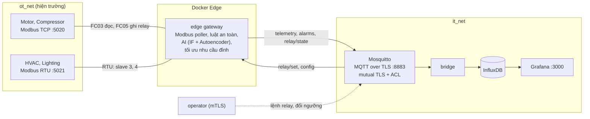

# Kiến trúc hệ thống

## 1. Sơ đồ tổng thể

Điểm thiết kế quan trọng:

- **Quyết định bảo vệ ở biên:** gateway tự ngắt relay, không phụ thuộc MQTT, InfluxDB hay Internet. Mất broker thì vẫn bảo vệ được và chỉ mất dữ liệu giám sát tạm thời.
- **Phân đoạn mạng:** simulator Modbus chỉ nằm trong `ot_net`; không có cổng Modbus nào được publish ra máy chủ. Chỉ gateway nối hai mạng.
- **Hai lớp phát hiện:** luật ngưỡng cứng (xác định, giải thích được, phản ứng nhanh với lỗi rõ ràng) và AI (phát hiện sớm lỗi tiến triển chậm chưa vượt ngưỡng).

## 2. Thiết bị Modbus

Mỗi tải là một slave (đồng hồ đa năng + relay). Holding register FC03, địa chỉ bắt đầu từ 0:

| Địa chỉ | Đại lượng | Hệ số | Đơn vị |
|---|---|---|---|
| 0 | Điện áp | x0.1 | V |
| 1 | Dòng điện | x0.01 | A |
| 2 | Công suất tác dụng | x1 | W |
| 3 | Hệ số công suất | x0.001 | |
| 4 | Tần số | x0.01 | Hz |
| 5 | THD dòng | x0.1 | % |
| 6 | Dòng rò | x0.1 | mA |
| 7 | Nhiệt độ | x0.1 | °C |
| 8, 9 | Điện năng (uint32, HI rồi LO) | x1 | Wh |
| 10 | Trạng thái, bit0 = relay đóng | | |
| 11 | Heartbeat | | |
| 100 | Kịch bản lỗi (chỉ simulator, ghi FC06) | | |

Coil 0 (FC01 đọc, FC05 ghi): relay, 1 = đóng, 0 = ngắt.

| Tải | Unit | Giao thức | Công suất định mức | Thứ tự cắt khi quá đỉnh |
|---|---|---|---|---|
| motor | 1 | TCP :5020 | 7.5 kW | không bao giờ bị cắt (trọng yếu) |
| compressor | 2 | TCP :5020 | 11 kW | 2 |
| hvac | 3 | RTU :5021 | 15 kW | 1 (cắt đầu tiên) |
| lighting | 4 | RTU :5021 | 3 kW | 3 |

## 3. Topic MQTT (tiền tố `factory/line1`)

| Topic | Hướng | Nội dung |
|---|---|---|
| `<tải>/telemetry` | gateway -> | JSON: điện áp, dòng, công suất, PF, THD, dòng rò, nhiệt độ, điểm AI |
| `<tải>/relay/state` | gateway -> (retained) | `closed`, `reason`, `latched` |
| `<tải>/relay/set` | -> gateway | `ON`, `OFF`, `RESET` |
| `alarms` | gateway -> | `load`, `severity`, `code`, `message`, `value` |
| `energy/summary` | gateway -> mỗi 5 s | tổng kW, ngưỡng, khung giờ, chi phí, kWh tiết kiệm, PF tổng |
| `config/demand_limit_kw` | -> gateway | số kW (1 đến 500) |
| `gateway/status` | gateway -> (retained, LWT) | `online` hoặc `offline` |

### Bảo mật

| Lớp | Biện pháp |
|---|---|
| Mã hóa đường truyền | TLS (>= 1.2), chỉ mở cổng 8883, không có listener 1883 |
| Xác thực | Mutual TLS: mỗi client có chứng chỉ riêng ký bởi CA nội bộ; tên người dùng = CN |
| Phân quyền | `mosquitto/acl`: gateway đọc/ghi `factory/#`; bridge chỉ đọc; operator chỉ ghi `relay/set` và `config/` |
| Tin cậy | Chứng chỉ ECDSA P-256, server có SAN `mosquitto`, `localhost`, `127.0.0.1` |
| Phân đoạn | Modbus chỉ trong `ot_net` |

## 4. Bảo vệ an toàn điện (luật cứng)

| Mã | Điều kiện | Hành động |
|---|---|---|
| OVERCURRENT_SHORT | I > 1.5 x định mức | ngắt ngay |
| OVERCURRENT | I > 1.2 x định mức trong 3 mẫu | ngắt |
| LEAKAGE | dòng rò > 30 mA trong 2 mẫu | ngắt |
| LEAKAGE_WARN | dòng rò > 15 mA | cảnh báo |
| UNDERVOLTAGE / OVERVOLTAGE | U < 352 V / U > 440 V trong 3 mẫu | ngắt |
| OVERTEMP | nhiệt độ > 85 °C | ngắt (cảnh báo từ 75 °C) |
| THD_HIGH | THD > 12 % trong 5 mẫu | cảnh báo |
| COMM_LOSS | mất 3 lần đọc Modbus liên tiếp | cảnh báo |

Relay ngắt do sự cố bị khóa cho đến khi nhận `ON`/`RESET`. Ngắt do quản lý nhu cầu (`demand_shed`) thì tự đóng lại.

## 5. AI phát hiện bất thường tại biên

- **Dữ liệu huấn luyện:** 6000 mẫu vận hành bình thường cho từng tải (nhiều giờ trong ngày) sinh từ mô hình vật lý; không cần nhãn lỗi (học không giám sát).
- **Đặc trưng (8):** điện áp, dòng, công suất, PF, THD, dòng rò, nhiệt độ, độ gợn dòng (độ lệch chuẩn tương đối trong cửa sổ 10 mẫu).
- **Mô hình 1, Isolation Forest** (150 cây): điểm > 0 là bất thường.
- **Mô hình 2, Autoencoder** MLP 8-6-3-6-8: sai số tái tạo vượt ngưỡng (phân vị 99.5 % x 1.5) là bất thường. Tỉ số `ae_ratio` > 1 là bất thường.
- **Lọc báo động giả:** bộ đếm mẫu bất thường liên tiếp (tăng 1 khi bất thường, giảm 2 khi bình thường). Đạt 5 thì cảnh báo `AI_ANOMALY`; đạt 30 và `AI_TRIP=true` thì ngắt phòng ngừa `AI_TRIP`.
- **Khởi động lại tải:** 30 s đầu sau khi relay đóng, AI không chấm điểm (tải đang nguội/khởi động). Trong 3 s sau mỗi lệnh relay, gateway bỏ qua việc đọc lệch trạng thái vì thanh ghi thiết bị cập nhật trễ.
- **Triển khai:** mô hình lưu ở volume `models`, nạp khi gateway khởi động; suy luận mỗi chu kỳ 1 s trên CPU, không cần Internet.

## 6. Tối ưu năng lượng

1. **Giảm đỉnh công suất:** tổng kW vượt ngưỡng trong 3 mẫu thì cắt tải có `shed_order` nhỏ nhất đang đóng; chờ 5 s giữa hai lần cắt.
2. **Đóng lại có trễ (hysteresis):** chỉ đóng lại khi tổng kW + công suất ước tính của tải đó <= 85 % ngưỡng, liên tục 15 mẫu.
3. **Biểu giá TOU:** thấp điểm 22:00-04:00, cao điểm 09:30-11:30 và 17:00-20:00 (Thứ 2 đến Thứ 7). Giờ cao điểm ngưỡng đỉnh được siết còn 90 %.
4. **Chỉ số:** chi phí điện tích lũy (VND), điện năng tiết kiệm nhờ cắt đỉnh (kWh, VND), PF tổng.

## 7. Giới hạn đã biết (nên nêu trong báo cáo)

- Dữ liệu và lỗi là mô phỏng; chưa kiểm chứng trên thiết bị thật.
- Điện năng "tiết kiệm" là ước tính dựa trên công suất của tải trước khi bị cắt, không phải đo thực.
- CA tự ký và mật khẩu mặc định chỉ phù hợp phòng lab.
- Cắt tải HVAC/máy nén trong thực tế cần xét ràng buộc công nghệ (thời gian tối thiểu giữa hai lần khởi động, an toàn quy trình).
